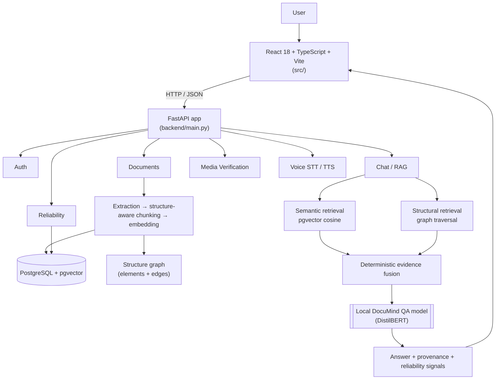

# MULTIMODAL STRUCTURE-AWARE DOCUMENT ANALYSIS AND DUAL-PATH GRAPHRAG QUESTION ANSWERING SYSTEM

**DocuMind** is a deterministic, evidence-first document-intelligence workspace. It
ingests real PDF/DOCX/TXT documents, preserves their document structure, retrieves
evidence through two independent paths — dense semantic search and document-native
graph traversal — fuses them deterministically, and answers questions with the
configured Groq LLM while exposing the evidence and reliability signals behind
every answer. The former custom extractive model is retired.

> **Current product pipeline (2026-10-30):** Student and Research workspaces use
> separate authenticated conversations. Student answers support 5/10/15-mark
> depth instructions with 8k/12k/16k context budgets. Retrieval combines dense
> MiniLM vectors and PostgreSQL full-text ranks, source-backed entity paths,
> a provisioned CPU cross-encoder, and full contiguous topic expansion.
> Missing structure/model assets and partial context are reported explicitly.

### RAG setup and verification

From `backend/`, using the existing Python environment:

```powershell
venv/Scripts/python.exe -m alembic upgrade head
venv/Scripts/python.exe -m embeddings.provision_model
venv/Scripts/python.exe -m embeddings.provision_reranker
venv/Scripts/python.exe -m evaluation.production_rag self-check
venv/Scripts/python.exe -m uvicorn main:app --host 127.0.0.1 --port 8000
```

Configure server-only `GROQ_API_KEY` in `backend/.env`. Weights, uploads and
environment files are excluded from Git. New uploads use structure-v2; the
authenticated document reprocess endpoint archives the old derived index and
replaces it atomically. Revision sources remain accessible through
`/api/documents/{id}/index-revisions` and the revision `/sources` endpoint.
Never mix embeddings from different models in the same active vector space.
The baseline encoder is pinned and verified; runtime loading is offline. Graph
rebuilds resume from the last validated chunk and retain partial-coverage status
when a provider limit interrupts processing. Unheaded paragraphs retain source
element identities so retrieval can recover their remaining child chunks.

See [production RAG audit](backend/architecture/DOCUMIND_PRODUCTION_RAG_AUDIT_2026-10-29.md)
and [evaluation commands](backend/evaluation/production_rag.md) for measured
limits and reproducible comparisons. A lexical support check is not factual
entailment or an official exam grade. Historical research descriptions below
are retained and may describe retired engines.

> This README describes the **actual current implementation** in this repository.
> Where a capability is unavailable or unverified, it says so explicitly. No metric,
> confidence, retrieval result, or model output in this document is fabricated.
> The authoritative long-form context is [`DOCUMIND_PROJECT_CONTEXT.md`](./DOCUMIND_PROJECT_CONTEXT.md).

---

## Table of contents

1. [Overview](#1-overview)
2. [Core capabilities](#2-core-capabilities)
3. [Architecture](#3-architecture)
4. [Dual-path / structure-aware design](#4-dual-path--structure-aware-design)
5. [Media Verification](#5-media-verification)
6. [Voice](#6-voice)
7. [Reliability / provenance](#7-reliability--provenance)
8. [Evaluation framework](#8-evaluation-framework)
9. [Technology stack](#9-technology-stack)
10. [Repository structure](#10-repository-structure)
11. [Local development](#11-local-development)
12. [Docker deployment](#12-docker-deployment)
13. [Testing](#13-testing)
14. [API overview](#14-api-overview)
15. [Security & privacy](#15-security--privacy)
16. [Research limitations](#16-research-limitations)
17. [Roadmap](#17-roadmap)
18. [License & contribution](#18-license--contribution)

---

## 1. Overview

### The problem

Conventional document-QA systems flatten documents to plain text, split them into
chunks, embed the chunks, and retrieve with dense vector search. That pipeline discards
much of what makes a document a document: headings, sections, pages, tables, and the
relationships between neighbouring pieces of evidence. Questions that depend on a
section, span a page break, reference a table, or require more than one hop are
therefore poorly served, and a vector score alone gives little traceable provenance.

### What DocuMind does

DocuMind keeps the document's own structure and uses it as a second retrieval path:

```
UPLOAD → EXTRACT → CHUNK → EMBED → RETRIEVE → UNDERSTAND → ANSWER → PROVIDE EVIDENCE → MEASURE RELIABILITY
```

- **Semantic path** — question embedding → pgvector cosine search → top-K chunks.
- **Structural path** — question/semantic seeds → document structure graph traversal → structural candidates.
- **Fusion** — the two rankings are combined deterministically, preserving the real
  retrieval score, the path that produced each source, the fusion score, structural
  hops, heading path, page and section.
- **Answering** — the project's own trained DistilBERT QA model, loaded from local
  artifacts. If it is unavailable, the system reports unavailable; it never substitutes
  another model or hardcodes an answer.

### Why structure matters

Structure-aware parsing and traversal let the system surface the section that owns a
fact, the table a value lives in, or the next/previous chunks around a matched
passage — evidence that flat chunking tends to lose. Whether this measurably improves
evidence sufficiency and answer quality is treated as a research question to be
**measured** (§ [Evaluation](#8-evaluation-framework)), not assumed.

### Multimodal capabilities

DocuMind is multimodal in two implemented senses: it ingests multiple document formats
(PDF, DOCX, TXT, including tables and figures as structure elements) and it exposes
image-based media verification plus speech-to-text and text-to-speech through the same
API and workspace.

---

## 2. Core capabilities

| Capability | Status | Where |
|---|---|---|
| Email/password auth + JWT sessions | Implemented | `backend/auth/` |
| Document upload (PDF / DOCX / TXT) | Implemented | `backend/documents/routes.py` |
| Structure-aware PDF parsing (sections, paragraphs, tables, text blocks) | Implemented | `backend/documents/parser.py` |
| Document structure persistence (elements + edges) | Implemented | `backend/documents/structure.py`, `backend/graph/models.py` |
| Structure-aware, token-budgeted chunking | Implemented (selectable) | `backend/documents/chunking.py` |
| 384-dim embeddings + pgvector search | Implemented | `backend/embeddings/`, `backend/storage/database.py` |
| Document-native structure/chunk graph (NEXT/PREV/SAME_PAGE/SAME_SECTION) — **not** a knowledge graph | Implemented | `backend/graph/service.py` |
| Structure graph traversal (parents, children, descendants, neighbourhood) | Implemented | `backend/graph/service.py` |
| Deterministic evidence fusion | Implemented | `backend/graph/evidence.py` |
| Dual-path RAG wired into the Brain | Implemented | `backend/brain/adapters.py`, `backend/chat/rag.py` |
| Reliability / provenance snapshot | Implemented | `backend/reliability/` |
| Document insights (stored-data-only) | Implemented | `backend/documents/routes.py` (`/{id}/insights`) |
| Media verification (image, local ViT model) | Implemented | `backend/verification/` |
| Voice STT (local Whisper) | Implemented | `backend/voice.py` |
| Voice TTS (local Piper voice by default; gTTS opt-in) | Implemented | `backend/voice.py` |
| Stateful conversation (LangGraph turn + Redis memory) | Implemented — Redis is used when reachable; otherwise the API **reports** `memoryBackend: "memory"`. Instruct generator is opt-in and **not** the measured best on the frozen benchmark (see `backend/architecture/DOCUMIND_MODEL_SELECTION_2026-10-17.md`) | `backend/session/`, `backend/orchestration/`, `backend/conversation/`, `POST /api/conversation/{id}/messages` |
| Duplex voice over WebRTC (server-side Silero VAD + barge-in) | Implemented and measured locally — `aiortc` peer connection, `PiperAudioStreamTrack`, host ICE candidates only (no STUN/TURN). Replaced the former `WS /api/voice/stream` transport; see `backend/architecture/DOCUMIND_WEBRTC_VOICE_2026-10-24.md` | `backend/voice_webrtc.py`, `backend/voice_vad.py`, `src/lib/voiceStream.ts` |
| Offline, deterministic evaluation harness | Implemented | `backend/evaluation/structure_eval.py` |
| Docker / production runtime | Implemented, **runtime-verification blocked** | `compose.yaml`, `backend/Dockerfile`, `Dockerfile.frontend` |
| OCR / scanned-document support | Implemented for **text** (`rapidocr` 3.10.0 on ONNX Runtime, CPU-only, offline; runs only on pages with no usable text layer). Measured CER 0.000 on 300-dpi digital-quality scans, 2.9 s/page, 745 MiB peak RSS, 0 VRAM. **Not** a document parser: scanned tables, columns, handwriting and formulas are not reconstructed — see `backend/architecture/DOCUMIND_OCR_ENGINE_DECISION_2026-10-24.md` | `backend/documents/ocr.py`, `backend/documents/processing.py` |
| Chart / layout understanding | **Not implemented** | — |
| Document-manipulation detection | **Not implemented** (distinct from image media verification) | — |
| Grounded generative answering (local Flan-T5, opt-in engine) | Partially implemented — below the extractive baseline on EM/F1 (see §8) | `backend/generation/`, `POST /api/generation/answer` |
| Local generator model selection | Retained `google/flan-t5-base`; Qwen2.5-0.5B-Instruct evaluated and rejected (EM 0.093 vs 0.129, 8.7× slower), config sweep within noise | `backend/architecture/DOCUMIND_MODEL_SELECTION_2026-10-17.md` |
| Claim-level evidence verification | Lexical attribution is the default. A relation-aware verifier (3-way claim verdicts, contradiction handling) is **opt-in** (`DOCUMIND_VERIFIER=relations`): held-out claim false-accepts 0.571 → 0.000, but frozen-benchmark EM is unchanged and token F1 falls 0.257 → 0.230, so it is not the default | `backend/architecture/DOCUMIND_EVIDENCE_VERIFICATION_2026-10-17.md` |
| Exam-answer engine (5/10/15 marks) | **Implemented — measured** on the graded fixture (words 17/49/73, key-fact recall 0.62/0.77/0.93, all SUPPORTED); depth is bounded by evidence breadth, so identical output is still possible where only one point is supported — see §55 of `DOCUMIND_PROJECT_CONTEXT.md` | `backend/generation/planning.py` |
| Mathematical reasoning | **Not implemented** | — |
| Knowledge-graph / entity–relation GraphRAG | **Not implemented** (current graph is document-native structure only) | — |
| `/api/user/*` (profile, preferences) | **Removed** — identity and settings are served by `GET /api/auth/me` and `GET/PATCH /api/settings`; no profile/preferences API remains registered | `backend/main.py` |

---

## 3. Architecture

DocuMind is a React/TypeScript single-page application talking to a FastAPI backend,
backed by PostgreSQL with the pgvector extension. There is **no** `frontend/`
directory and **no** separate API package — the frontend lives at `src/` and the
backend at `backend/`.



### Request and processing flow

1. **Auth** — `POST /api/auth/login` returns a JWT; every subsequent request is
   authorised from that token (`backend/auth/dependencies.py` → `CurrentUser`).
2. **Ingestion** — `POST /api/documents/upload` stores the file, extracts text and
   structure, chunks it, embeds it, builds graph edges, and marks the document
   `READY` only after every required stage succeeds (otherwise `ERROR`).
3. **Retrieval** — `POST /api/chat/ask` embeds the question, runs the semantic path
   and the structural path, fuses the evidence deterministically, and builds the QA
   context.
4. **Answering** — the local QA model produces an answer span; `factual_grounded` is
   the honest signal that the answer span occurs in the supplied context.
5. **Reliability** — the latest query snapshot is persisted per user and read back by
   `GET /api/reliability/last-query`.

The FastAPI `lifespan` also brings the database schema to `alembic head` at startup,
so the application cannot silently run against an out-of-date schema.

---

## 4. Dual-path / structure-aware design

### Semantic (chunk) path

Question → `all-MiniLM-L6-v2` embedding (384-dim) → pgvector cosine search →

top-K chunks, each carrying its real similarity score. This is real server-side
pgvector distance (`1 - (embedding <=> CAST(:e AS vector))`); FAISS, SQLite and
in-memory cosine search are **not** used as production substitutes.

### Structural path

The structural path never invents relevance. It traverses the document's own graph:

- **Chunk graph** (`backend/graph/service.py`): `NEXT`, `PREV`, `SAME_PAGE`,
  `SAME_SECTION` edges derived at ingestion from reading order, page and heading path.
- **Structure graph** (`backend/graph/models.py`, migration `006`): `DocumentStructureElement`
  rows (page, section, paragraph, text block, table, table row/cell, figure, list,
  list item) linked by `DocumentStructureEdge` relations `CONTAINS`, `PARENT_OF`,
  `NEXT`, `REFERENCES`, `BELONGS_TO_PAGE`.
- Traversal helpers: `get_structure_element`, `get_direct_children`, `get_parent_chain`,
  `get_descendants`, `get_structural_neighborhood` (all bounded and cycle-safe).

### Evidence fusion

`backend/graph/evidence.py` is a **pure, deterministic, database-independent** fusion
service. It:

- normalises semantic (`chat.rag.SourceChunk`) and structural
  (`DocumentStructureElement`) inputs into one `EvidenceItem` contract;
- preserves real provenance per item — `document_id`, source record id, `source_type`
  (`semantic` / `structure`), page, sequence index, element type, heading path,
  section, retrieval path, structural hops, relation;
- **never fabricates a score**: semantic evidence keeps its real pgvector similarity
  (`score_source = "pgvector_similarity"`); structural evidence has **no** similarity
  score (`score = None`);
- de-duplicates by real persisted identity `(document_id, source_type, record_id)` and
  bounds each stream deterministically;
- refuses to silently mix documents (`allow_multi_document=False` by default).

### What is intentionally *not* inferred

There is **no persisted chunk → structure mapping**. The system does not guess that a
semantic chunk "belongs to" a particular structure element. Instead, structural
evidence is collected as a **separate stream** (document-scoped, bounded) and fused by
identity — so the two paths contribute without a fabricated correspondence. Any
relationship not actually recorded at ingestion is left unmade.

---

## 5. Media Verification

`POST /api/verification/analyze` classifies a single uploaded **image** with the
project's locally provisioned model:

- **Model**: `prithivMLmods/Deep-Fake-Detector-v2-Model` (`ViTForImageClassification`),
  revision `3a99ae26f52c7ac7c3a53103b6cf3a8b617f7093`, labels **`Realism`** and
  **`Deepfake`**. Provenance is in `backend/models/media-verification/MANIFEST.json`.
- **Local inference**: loaded once per process from `backend/models/media-verification`
  (`local_files_only=True`), CPU, run in a worker thread with a bounded timeout.
- **Supported images**: PNG, JPEG, GIF, BMP, WEBP. Validation checks size, extension,
  declared MIME **and magic bytes** — the client's declared type is never trusted over
  the actual content.
- **Response semantics**: `verdict` is the model's own predicted label and `score` is
  its softmax probability for that class, alongside the model name/revision and
  bounded processing metadata (bytes, width, height, elapsed ms).
- **Honest failure**: model unavailable → `503`; malformed/unsupported input → `400`/`415`;
  timeout → `504`; unexpected failure → generic `500` with no internal detail leaked.

### Limitations

This is a model classification, **not forensic proof**. A `Deepfake` or `Realism`
label describes what this model predicted for this input; it is not a determination of
authenticity, and no confidence/risk/manipulation metric is produced. Accuracy is not
claimed here beyond the model card's own documentation.

---

## 6. Voice

Both endpoints are authenticated and operate on the project's local model strategy.

- **Speech-to-text** — `POST /api/voice/transcribe` runs the locally provisioned
  **faster-whisper small** model (`backend/models/whisper/small`), CPU / int8,
  `local_files_only=True`, once per process, off the event loop. Audio is written to an
  OS-generated temporary file (never a client-derived path) and removed on every exit
  path. If the model cannot load, the endpoint returns an honest `503` and never
  fabricates a transcript.
- **Text-to-speech** — `POST /api/voice/synthesize` synthesises speech with the
  **provisioned local Piper voice** (`TTS_ENGINE=local`, the default) on the CPU: no
  network, no VRAM, `audio/wav`, and the answer text never leaves the machine. A
  missing voice artifact is an honest `503`; there is **no** silent fallback to the
  network. `TTS_ENGINE=gtts` keeps the previous Google Translate path (external
  network, `audio/mpeg`), reported truthfully in the call's `ready` message (`tts` field).

- **Streaming conversation (voice)** — `POST /api/voice/webrtc/offer` negotiates one
  `RTCPeerConnection` per conversation (`aiortc`). The microphone track goes up, the
  server transcribes with local Whisper, runs the same LangGraph turn the text API uses,
  and streams the answer back through `PiperAudioStreamTrack` (16 kHz mono, 20 ms frames,
  silence on underrun so PTS stays monotonic and playback cannot drift). The JSON turn
  protocol travels over the `control` data channel the browser creates in its offer.
  ICE uses host candidates only — no STUN/TURN, so a local evaluation never needs the
  internet. Conversation memory lives in Redis
  (`documind:conversation:{user_id}:{session_id}`, TTL + trim); if Redis is unreachable the
  server falls back to process-local memory and says so in `memoryBackend` — it never
  claims Redis.

**Turn-taking and barge-in are decided on the server** by Silero VAD
(`backend/voice_vad.py`, ONNX Runtime CPU, local weights; per-stream recurrent state,
512-sample windows with the reference 64-sample context):

* the turn **ends on a natural pause** (default 700 ms of silence after at least 200 ms
  of speech), so no tap is needed and a turn nobody speaks into is never uploaded;
* **speaking over the answer interrupts it** — the microphone stays attached during
  playback, and sustained speech cancels the in-flight turn task, clears the queued TTS
  audio and returns to listening (`{"type":"interrupted","reason":"vad"}`);
* the microphone stays live between turns, so a conversation can carry on without
  tapping; a tap sends an explicit `barge_in` over the control channel.

The client (`src/lib/voiceStream.ts`) is transport-only: it negotiates the peer
connection, attaches the microphone with `replaceTrack` (no re-offer per turn), plays the
remote track through an `<audio>` element, and renders the phases the server reports.
There is no client-side VAD any more — the browser's detector was removed when the server
took over the decision, so the two cannot disagree. Measured locally on 2026-10-24 (see
`backend/architecture/DOCUMIND_WEBRTC_VOICE_2026-10-24.md`): ICE connected over host
candidates, a spoken question was transcribed verbatim, the answer came back and was
spoken through the track, and speech over that answer cancelled the turn.

The workspace UI exposes voice input on the workspace page and, in conversation mode, a
single streaming voice control with a live level meter, tap-or-speak interrupt and the
server-reported phase. Loading, error and unavailable states are represented rather than
faked; when the VAD model cannot load, the control says so instead of pretending
barge-in works.

---

## 7. Reliability / provenance

The Reliability Center surfaces what the most recent query actually used. Persisted per
user (`reliability_logs`, one upserted row per user) and read via
`GET /api/reliability/last-query`:

- `question`, `answer`, `qaConfidence`, `retrievalScore`, `avgRetrievalScore`
- `sourceCount`, `uniqueDocuments`, `factualGrounded`, `insufficientContext`
- per-source refs with `relevanceScore`, `page`, `status`
  (`VERIFIED` / `MARGINAL` / `UNRESOLVED`), `retrievalPath`
  (`semantic` / `structural` / `hybrid`), `fusionScore`, `structuralHops`,
  `evidenceKind` (`chunk` / `structure_element`)
- evidence-sufficiency provenance: `semanticSourceCount`, `structuralSourceCount`,
  `structuralElementSourceCount`, `hybridSourceCount`, `structuralHopMax`,
  `pathAgreement`

These are **measured signals derived from the actual sources of that query**, not
guesses. Note the naming chosen deliberately by the implementation: `fusionScore` is a
reciprocal-rank fusion score, **not** a similarity; `score_source` names where a
similarity came from. The system does not label any value "risk", "hallucination
probability", or invented confidence.

---

## 8. Evaluation framework

Research evaluation lives in `backend/evaluation/` (physically separate from
production; never imported by routes and never collected by pytest). Two layers exist:

1. **Production/pgvector ablation** — `evaluation/experiments/run_dual_path_ablation.py`
   runs the real pipeline (PostgreSQL + pgvector + local model) over labelled corpora
   and writes reports.
2. **Offline, deterministic structure-aware harness** —
   `evaluation/structure_eval.py` runs **without any database, pgvector, embeddings or
   local model**, over a small synthetic structure-labelled fixture
   (`evaluation/datasets/structure_eval_corpus.py`).

The offline harness compares four variants:

| Variant | Retrieval |
|---|---|
| `A_semantic_only` | lexical scoring over chunk text |
| `B_dual_path_chunk` | chunk scoring interleaved with same-section chunk-graph expansion |
| `C_structure_aware` | element scoring over content + heading path, with section parents |
| `D_fused_dual_path` | chunks + elements fused through `graph.evidence.fuse_evidence` |

It **separates three questions**: retrieval quality (Recall@K / Precision@K / MRR /
nDCG@K against hand-authored gold), answer quality (exact match / token-set F1 /
accuracy), and grounding (page, section, evidence-type coverage, answer-source
grounding). Reports are **deterministic** — two runs over the same corpus are
byte-identical — and a metric whose population is empty is reported as `null` with a
reason, **never** `0.0`.

```bash
cd backend
./venv/Scripts/python.exe evaluation/structure_eval.py
```

### Generative answer evaluation

Three reproducible scripts measure the local generator on the frozen 182-question
benchmark and on a graded mark-depth fixture (each writes its own report directory; none
overwrites a historical report):

```bash
cd backend
./venv/Scripts/python.exe -m evaluation.experiments.run_generation_benchmark --format 10
./venv/Scripts/python.exe -m evaluation.experiments.run_mark_depth_evaluation
./venv/Scripts/python.exe -m evaluation.experiments.run_generation_config_sweep
```

Candidate evaluation is a separate runner:

```bash
./venv/Scripts/python.exe -m evaluation.experiments.run_candidate_model_evaluation
```

Current decision: **retain `google/flan-t5-base`** — the config sweep found no quality
change beyond noise, and the approved candidate `Qwen/Qwen2.5-0.5B-Instruct` scored
EM 0.093 / F1 0.189 at 1918 ms p50 against the incumbent's 0.129 / 0.257 at 220 ms
([`backend/architecture/DOCUMIND_MODEL_SELECTION_2026-10-17.md`](backend/architecture/DOCUMIND_MODEL_SELECTION_2026-10-17.md)).

### Limitations

This offline harness measures **reference lexical baselines** on a small synthetic
fixture; it makes no claim about pgvector behaviour or the production QA model's answer
quality. The extractive answer step is deliberately simple. No external LLM judge and
no network are used. See [`backend/evaluation/README.md`](backend/evaluation/README.md).

---

## 9. Technology stack

**Backend** (Python 3.11, `backend/requirements.txt`): FastAPI 0.115.6, Uvicorn 0.34,
Pydantic 2.10 / pydantic-settings, SQLAlchemy 2.0 (async) + asyncpg 0.30, Alembic 1.14,
pgvector 0.5, python-jose (JWT HS256), passlib/bcrypt, python-multipart,
PyMuPDF (PDF), python-docx (DOCX), sentence-transformers (`all-MiniLM-L6-v2`, 384-dim),
PyTorch 2.13 + Transformers 5.16 (local DistilBERT QA), faster-whisper 1.2 /
CTranslate2 4.8 / PyAV 18 / onnxruntime (STT and local TTS), piper-tts 1.3 (TTS,
local default), gTTS 2.5 (TTS, opt-in), Pillow + torchvision (image verification).
Testing: pytest 8.3 + pytest-asyncio + aiosqlite.

**Frontend** (`package.json`): React 18.3, TypeScript 5.7, Vite 6.1, Tailwind CSS 3.4,
PostCSS + Autoprefixer, Three.js 0.173.

**Database**: PostgreSQL with the **pgvector** extension (server-side). Vector
similarity is real pgvector cosine distance.

---

## 10. Repository structure

```
(repository root)/
├── src/                      # React + TypeScript + Vite frontend (NOT "frontend/")
│   ├── pages/                # 5 pages: Login, Workspace, Verification, Reliability, Settings
│   ├── components/{3d,common}
│   ├── context/
│   ├── lib/api.ts            # the single typed backend API client
│   ├── types/
│   └── App.tsx, main.tsx, index.css
├── backend/                  # FastAPI backend
│   ├── main.py               # app, CORS, lifespan (runs migrations), /api/health
│   ├── config.py             # pydantic-settings + get_settings()
│   ├── voice.py              # STT (Whisper) + TTS (local Piper, or gTTS)
│   ├── tokenization.py, outcomes.py, answer_span.py
│   ├── auth/ documents/ embeddings/ chat/ brain/ reliability/ verification/ settings/ user/
│   ├── graph/                # models.py, service.py (traversal), evidence.py (fusion)
│   ├── storage/              # database.py, file_store.py
│   ├── migrations/           # Alembic env.py + versions/000..010
│   ├── models/               # provisioned models (documind-qa/, whisper/, media-verification/)
│   ├── evaluation/           # research evaluation (offline harness + experiments)
│   ├── tests/                # pytest suite (SQLite-backed; no Postgres needed)
│   ├── scripts/              # setup_db.py, create_test_user.py, start_server.py, ...
│   ├── alembic.ini, requirements.txt, pytest.ini
│   └── uploads/              # runtime upload storage (gitignored)
├── runbooks/                 # operational incident runbooks (incl. docker-runtime.md)
├── docker/nginx.conf         # frontend static server + /api reverse proxy
├── compose.yaml              # db + backend + frontend
├── Dockerfile.frontend, backend/Dockerfile, backend/docker-entrypoint.sh
├── .dockerignore, backend/.dockerignore
├── .env.example              # Docker Compose template (names only)
├── index.html, package.json, vite.config.ts, tailwind.config.js, tsconfig.json
├── AGENTS.md, CONTEXT.md, DOCUMIND_PROJECT_CONTEXT.md
├── PRD.md, DESIGN.md, ARCHITECTURE.md
└── README.md                 # this file
```

Paths that do **not** exist (older prompts referenced them incorrectly): `frontend/`,
`backend/api/`, `backend/services/`, `backend/core/`, `faiss_indexes/`.

---

## 11. Local development

### Prerequisites

- Python 3.11, Node.js 22 (or an LTS equivalent), and a reachable **PostgreSQL with the
  pgvector extension** for real end-to-end use.
- The downstream model artifacts (§ model provisioning below). The test suite runs
  without them; the QA / voice / verification **endpoints** require them.

### Backend

```bash
cd backend

# 1. Virtual environment (Windows paths shown; use venv/bin/... on Linux/macOS)
python -m venv venv
./venv/Scripts/python.exe -m pip install --upgrade pip

# 2. Dependencies. Note: gTTS declares click<8.2, which conflicts with
#    huggingface_hub's click requirement, so install it separately (see the
#    note in requirements.txt). The Docker image does exactly this.
./venv/Scripts/python.exe -m pip install -r requirements.txt

# gTTS is optional (only for TTS_ENGINE=gtts). Provision it with:
./venv/Scripts/python.exe -m pip install --no-deps gTTS==2.5.4

# Local TTS voice (63 MB, LJSpeech — public domain). Without it TTS returns 503.
./venv/Scripts/python.exe -m piper.download_voices en_US-ljspeech-medium --data-dir models/tts

# 3. Configuration — copy the template and set real values
cp .env.example .env        # then edit DATABASE_URL, JWT_SECRET_KEY, ...

# 4. Create the schema (or let the app migrate at startup)
./venv/Scripts/python.exe scripts/setup_db.py
./venv/Scripts/python.exe -m alembic upgrade head

# 5. Create a user (there is no signup endpoint)
./venv/Scripts/python.exe scripts/create_test_user.py \
  --email you@example.com --password 'Pass123!' --name "Your Name"

# 6. Run
./venv/Scripts/python.exe -m uvicorn main:app --host 127.0.0.1 --port 8000
# or, with a readiness wait:
./venv/Scripts/python.exe scripts/start_server.py
```

Health: `curl http://127.0.0.1:8000/api/health`

### Frontend

```bash
# from the repository root
npm install
npm run dev        # Vite dev server on http://localhost:3000 (proxies /api → :8000)
npm run build      # typecheck + production build into dist/
```

### Environment variables

Names and purpose (values live in `backend/.env` for local dev, gitignored):

| Variable | Purpose |
|---|---|
| `DATABASE_URL` | PostgreSQL asyncpg URL (`postgresql+asyncpg://...`) |
| `JWT_SECRET_KEY` | HS256 signing key (required in production) |
| `JWT_ALGORITHM`, `JWT_EXPIRE_MINUTES` | Token settings |
| `CORS_ORIGINS` | Comma-separated allowed frontend origins |
| `UPLOAD_DIR`, `MAX_UPLOAD_SIZE_MB` | File storage path and size cap |
| `QA_MODEL_NAME` | Local QA model directory |
| `WHISPER_MODEL_NAME` | Local Whisper model directory |
| `EMBEDDING_MODEL` | Local embedding directory or Hub id |
| `TTS_ENGINE` | `local` (default, Piper) or `gtts` — no automatic fallback between them |
| `TTS_VOICE` | Piper voice id (default `en_US-ljspeech-medium`) |
| `TTS_MODEL_PATH` | Explicit `.onnx` voice path; empty resolves `models/tts/<TTS_VOICE>.onnx` |
| `CHUNKER_VERSION` | `legacy` (default) or `structure-v2` |
| `VITE_API_BASE_URL` | Frontend API base (empty = same origin) |

### Model provisioning

Models are **operator-provisioned local assets** and are gitignored. Do not move or
retrain them.

| Model | Location | Notes |
|---|---|---|
| QA (trained DistilBERT) | `backend/models/documind-qa` | required for `/api/chat/ask` |
| Whisper small (CTranslate2) | `backend/models/whisper/small` | required for `/api/voice/transcribe` |
| Piper voice (`en_US-ljspeech-medium`) | `backend/models/tts/en_US-ljspeech-medium.onnx` | required for TTS with `TTS_ENGINE=local`; provision with `python -m piper.download_voices` |
| Media verification (ViT) | `backend/models/media-verification` | required for `/api/verification/analyze` |
| Embeddings (`all-MiniLM-L6-v2`) | local `backend/models/all-MiniLM-L6-v2` if present, else the HuggingFace cache | first use may download if not local |

### Migrations

Alembic is the sanctioned schema path; the chain is linear, currently head **`010`**
(verified 2026-10-24, `alembic heads` → `010 (head)`; `010` adds the reverse
`(target, relation)` edge indexes used by the 15-mark graph expansion):

```bash
cd backend
./venv/Scripts/python.exe -m alembic heads      # 010 (head)
./venv/Scripts/python.exe -m alembic upgrade head
```

---

## 12. Docker deployment

A production-style Compose stack is implemented:

| Service | Image / build | Host port |
|---|---|---|
| `db` | `pgvector/pgvector:pg16` | internal only (not published) |
| `backend` | `backend/Dockerfile` | `127.0.0.1:8000` |
| `frontend` | `Dockerfile.frontend` (Vite → nginx) | `8080` |

The backend image runs as a non-root user, applies the existing Alembic migration
chain at startup, and validates the provisioned models before serving. QA / Whisper /
media models are mounted read-only (`./backend/models:/app/models:ro`); the embedding
model is pre-fetched at build time. No `.env` or secret is baked into any image.

```bash
# prerequisites: a repo-root .env with POSTGRES_PASSWORD and JWT_SECRET_KEY
cp .env.example .env

docker compose config
docker compose build
docker compose up -d
docker compose ps
docker compose logs backend
curl http://localhost:8000/api/health
```

> **Docker runtime verification is environment-dependent and has NOT been claimed as
> successful on the development machine, because no Docker engine is available there.**
> The static configuration (Compose YAML, entrypoint script, `.dockerignore`, secret
> handling, model paths) has been validated, and the host frontend build
> (`npm run build`) passes; the container **build, startup, health and end-to-end flows
> are unverified**. Do not treat this section as a passed runtime test.

Full operator instructions, health/readiness semantics, an authenticated smoke test and
troubleshooting are in [`runbooks/docker-runtime.md`](runbooks/docker-runtime.md).

---

## 13. Testing

The backend suite is pytest-based and SQLite-backed (no PostgreSQL required); the
frontend is checked by its TypeScript production build.

```bash
# Backend — full suite
cd backend
./venv/Scripts/python.exe -m pytest tests -q

# Backend — static migration graph (single head)
./venv/Scripts/python.exe -m alembic heads

# Frontend — typecheck + production build (from the repository root)
npm run build
```

**Test baseline (historical — not re-run for this revision).** The suite changes often;
`pytest --collect-only -q` reported **904** collected tests on 2026-10-09. The earlier
figures in this section and in the 2026-09-30 implementation report are stale snapshots —
do not cite a pass count you have not produced yourself. `alembic heads` → **010 (head)**;
`npm run build` → passes.

> The SQLite suite does not exercise pgvector, the real QA model, voice, or media
> verification, and it is **not** proof of an end-to-end pass. A genuine end-to-end
> verification requires a reachable PostgreSQL + pgvector database and provisioned
> models. Docker end-to-end verification has **not** been run (see §12).
>
> `tests/integration/rag/test_real_e2e_validation.py` provisions and drops its own
> database, so it runs only when the connection is authorized. Authorization is
> decided by the PostgreSQL server, read from the connection that will do the work
> (`backend/evaluation/lifecycle_authority.py`): the role must have `CREATEDB`, must
> not be `SUPERUSER`/`CREATEROLE`, must own the database it drops, and must be denied
> `CONNECT` on the application database. Provision the evaluation role once with
> `backend/scripts/provision_local_eval_cluster.py`, then set
> `DOCUMIND_INTEGRATION_DATABASE_URL` to that role's disposable database. Without it
> the target derives from `DATABASE_URL`, the application role is a superuser, and the
> gates refuse — a reachable PostgreSQL alone is not sufficient for a zero-error run.
> Measured 2026-10-23: `1 passed` in 100.87 s, steps 4-7 all PASS
> (`backend/architecture/DOCUMIND_STATEFUL_CONVERSATION_2026-10-22.md` §6c).

---

## 14. API overview

All routes are authenticated except `POST /api/auth/login` and `GET /api/health`.
**Every route in the table below is implemented and registered**; no registered route raises
`NotImplementedError`. Unavailable capabilities report their real state through their own
responses (for example `POST /api/verification/analyze` returns 503 when its local model cannot
load, and removed paths return 404).

| Method | Path | Notes |
|---|---|---|
| GET | `/api/health` | service health + QA-model availability |
| POST | `/api/auth/login` | returns a JWT |
| POST | `/api/auth/logout` | |
| GET | `/api/auth/me` | current user profile |
| POST | `/api/documents/upload` | 201; PDF/DOCX/TXT |
| GET | `/api/documents` | list the user's documents |
| GET | `/api/documents/{id}` | document detail (paginated chunks) |
| GET | `/api/documents/{id}/insights` | stored-data-only structural/embedding/graph insights, plus per-page extraction provenance (`pages`) |
| DELETE | `/api/documents/{id}` | |
| POST | `/api/documents/{id}/reprocess` | re-run ingestion |
| POST | `/api/embeddings/generate` | embed text |
| POST | `/api/embeddings/search` | pgvector similarity search |
| POST | `/api/chat/ask` | RAG + dual-path evidence + local QA (extractive default); `"engine": "generative"` opts into the local Flan-T5 path with `answerFormat` 5/10/15 |
| POST | `/api/generation/answer` | additive generative answer: local Flan-T5, evidence-only prompt, deterministic verification, 5/10/15 marks |
| GET | `/api/chat/sessions` | list sessions |
| POST | `/api/chat/sessions` | create session |
| GET | `/api/chat/sessions/{id}/messages` | list messages |
| POST | `/api/chat/sessions/{id}/messages` | add message |
| POST | `/api/verification/analyze` | image media verification (local model) |
| GET | `/api/reliability/last-query` | latest query reliability snapshot |
| GET | `/api/settings` | user settings |
| PATCH | `/api/settings` | update settings |
| POST | `/api/voice/transcribe` | local Whisper STT |
| POST | `/api/voice/synthesize` | local Piper TTS (WAV) by default; gTTS (MP3) when selected |
| POST | `/api/voice/webrtc/offer` | SDP offer/answer for the duplex voice call (WebRTC, host ICE only); media carries streaming STT → LangGraph turn → streaming TTS, the `control` data channel carries the turn protocol and server-side VAD barge-in |
| GET | `/api/conversation/status` | which conversation-memory backend is actually in use |
| GET | `/api/conversation/{sessionId}` | stored multi-turn history |
| POST | `/api/conversation/{sessionId}/messages` | stateful answer (history → retrieve → rerank → generate → remember) |
| DELETE | `/api/conversation/{sessionId}` | forget a conversation |

The four declared `/api/user/*` routes (`GET/PUT /api/user/profile` and
`GET/PUT /api/user/preferences`) were **removed**, not implemented. Identity is
already served by `GET /api/auth/me` (`{name, email, avatarUrl}`) and persisted
settings by `GET/PATCH /api/settings`, so the routes were duplicates that always
raised `NotImplementedError` and took no authentication dependency. They are no
longer registered: requests to those paths return `404`.

OpenAPI docs are served by FastAPI at `/docs` when the app is running.

---

## 15. Security & privacy

- **Authentication** — email/password (bcrypt) with JWT HS256; the API derives
  ownership from the authenticated identity, never from client-supplied IDs.
- **Isolation** — documents, chunks, chat sessions, reliability rows and structure
  elements are scoped to the owning user.
- **Secrets** — supplied via environment / `backend/.env` (gitignored). No secret is
  committed, copied into a Docker image, or hard-coded. Compose requires
  `POSTGRES_PASSWORD` and `JWT_SECRET_KEY` to be provided and fails fast otherwise.
- **Local models** — QA, Whisper, the TTS voice and media verification run locally;
  there is no external LLM fallback. gTTS is opt-in only (`TTS_ENGINE=gtts`) and sends
  the answer text to Google Translate, so it is not the default. Model weights are
  read-only and never served through static routes.
- **Upload validation** — file type, size and (for images/audio) magic-byte content
  are validated; client-declared types are never trusted.
- **Database** — parameterized SQL only; PostgreSQL is internal to the Compose network
  and not published to the host by default.
- **Error handling** — internal stack traces and exception detail are not exposed to
  clients.
- **Rate limiting / account recovery / SSO** are **not** implemented; no compliance
  certification (e.g. SOC 2, HIPAA, GDPR) is claimed.

---

## 16. Research limitations

- **Evaluation corpus size** — the offline harness uses a small synthetic fixture; it
  is a harness validation, not a benchmark.
- **Offline lexical baselines** — the offline variants measure reference lexical
  retrieval, not the production embedding/pgvector pipeline or the production QA model.
- **Local model constraints** — QA, Whisper and media verification depend on locally
  provisioned artifacts; when absent, the affected endpoints report unavailable rather
  than degrading to a substitute.
- **Media verification** — a model classification, not forensic proof (§5).
- **No persisted chunk → structure mapping** — structural and semantic evidence are
  fused as separate streams by identity; no correspondence is fabricated (§4).
- **Docker verification blocker** — no Docker engine was available on the development
  machine, so container build/startup/health/E2E are unverified (§12).
- **SQLite test scope** — the test suite does not exercise pgvector, the real QA model,
  voice, or media verification end to end (§13).
- **Frontend end-to-end** — the production build passes; a real-browser E2E run was not
  performed in this environment.

---

## 17. Roadmap

Only genuinely remaining work is listed. Completed Sprint 1/2 features (auth,
ingestion, chunking, embeddings, pgvector retrieval, structure graph, dual-path fusion,
Brain wiring, Reliability Center, insights, media verification, voice, evaluation
framework, Docker artifacts) are **not** future work.

- Verify the Docker runtime end to end on a Docker-capable host (build, startup,
  migrations, health, authenticated smoke flows).
- Expand the evaluation corpora and measure the production dual-path pipeline, rather
  than only the offline lexical baselines.
- Advance the **retrieval + answer-path next stage** (sentence-window retrieval, query
  expansion, question-type routing, structure-linked chunks, and a grounded local
  generative answer path). This is **planned only** — nothing in it is implemented or
  authorized yet; the gated execution order, ownership and constraints are recorded in
  [`backend/architecture/phase4f_6/NEXT_STAGE_RAG_EXECUTION_PLAN.md`](backend/architecture/phase4f_6/NEXT_STAGE_RAG_EXECUTION_PLAN.md).
  **Implemented 2026-10-17 (partial):** a local Flan-T5-base path (`POST /api/generation/answer`,
  or `POST /api/chat/ask` with `{"engine": "generative"}`; `backend/generation/`) grounded in
  retrieved evidence with deterministic claim/citation verification and
  withhold-on-unattributable behaviour. The DistilBERT extractive model remains the **default**
  engine and the baseline. Mark depth is measured, not asserted: 10/15 marks add evidence
  sentences with their own citations (17 / 49 / 73 mean words; key-fact recall 0.62 / 0.77 /
  0.93, all SUPPORTED — `backend/evaluation/reports/mark_depth_2026-10-17/`). Known gaps: the
  generator is still **below** the extractive baseline on the frozen P3 benchmark (EM 0.129 vs
  0.157, F1 0.257 vs 0.387), it abstains on 95.2% of unanswerable rows where the baseline never
  does, and depth is bounded by evidence breadth (`DOCUMIND_PROJECT_CONTEXT.md` §0.8).
- Add real-browser end-to-end verification for the frontend.

---

## 17b. Direction reset and research roadmap

The current agreed product direction and the permanent **Phase 0–9** roadmap are in
[`DOCUMIND_PROJECT_CONTEXT.md`](DOCUMIND_PROJECT_CONTEXT.md) **Part 0 (§0, 2026-10-17)**. The
lecturer's recorded requirements, the label-complete capability matrix (implemented / partial /
unverified / planned / blocked / absent) and the original Phase 0–7 roadmap remain preserved in
**Part II (§50–§63)**; §57's numbering is mapped to Phase 0–9 by §0.4.1.
Phase 0 (failure audit and baseline evaluation) has priority; **nothing in that roadmap is
implemented or authorized**. Historical research results (populations P1/P2/P3, H1 metrics,
F2/G/H1/H1-R/E0) are preserved in **§0.7** and are **HISTORICAL**, not current measurements.
The architecture gate
(`backend/architecture/phase4f_6/decision/ARCHITECTURE_MIGRATION_GATE.md`) remains
**NOT OPEN**.

---

## 18. License & contribution

This repository **currently contains no `LICENSE` file and no `CONTRIBUTING` policy**.
No license is granted or implied here, and no contribution process is defined. Do not
assume one exists; if you intend to use or contribute to this project, add or request
the relevant license/contribution terms first.
