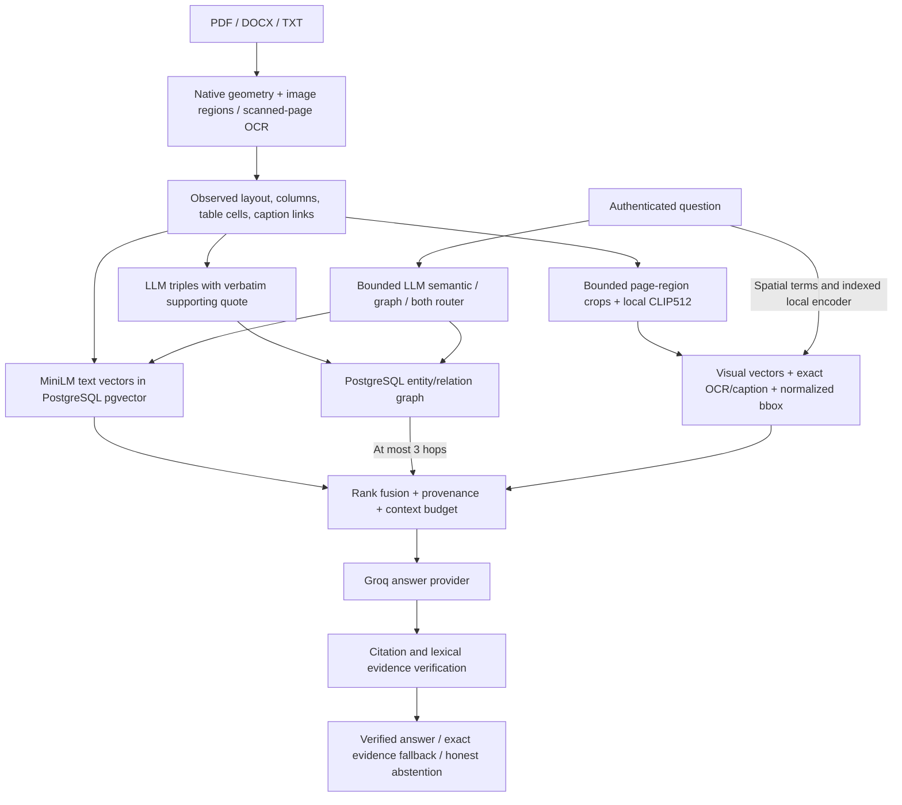

# Visual-spatial dual-path GraphRAG — 2026-10-28

Status: DECIDED by the owner's explicit request; validation below distinguishes
implementation from measured capability. This supersedes only the automatic
hosted-fallback prohibition in the 2026-10-27 workspace decision.

## Concept and implementation map



Production keeps PostgreSQL/pgvector and parameterized owner-scoped SQL. The SQL
entity/relation graph is the multi-hop path; document hierarchy edges alone are
not represented as entity GraphRAG. No second FAISS/Chroma/NetworkX persistence
path is introduced.

| Module | Responsibility |
| --- | --- |
| `generation/providers.py` | Shared bounded Groq completion, actual provider provenance and optional local-adapter compatibility |
| `documents/processing.py`, `spatial.py` | Page extraction, normalized geometry, multi-column reading order, table/caption association |
| `documents/visual_processing.py` | Bounded crop indexing reusing extracted layout and OCR |
| `embeddings/visual.py`, `visual_index.py` | Offline CLIP512, validated vectors, owner-scoped patch persistence/search |
| `documents/kg_extraction.py` | LLM triples; validates endpoints and verbatim quote before storage |
| `graph/service.py` | Owner-scoped entity linking and bounded multi-hop SQL traversal |
| `generation/query_router.py`, `service.py` | Semantic/graph/both routing, graph-miss dense rescue, fusion and spatial enrichment |
| `generation/provider_prompt.py`, `orchestration/service.py` | Budgeted text/geometry prompt, Student/Research intent, verification, chat and SSE |
| `main.py`, `requirements.txt` | Existing FastAPI entry point and pinned dependencies |

## Configuration and operation

`config.py` loads `backend/.env` by absolute path, with environment variables taking
precedence. This task does not write the environment file. Server-only settings:

```dotenv
ANSWER_PROVIDER=groq
ANSWER_AUTO_FALLBACK=false
GROQ_MODEL=openai/gpt-oss-20b
GROQ_TIMEOUT_SECONDS=30
# Supply GROQ_API_KEY through the backend environment, never Vite.
QUERY_ROUTER_ENABLED=true
QUERY_ROUTER_TIMEOUT_SECONDS=3
VISUAL_EMBEDDINGS_ENABLED=true
VISUAL_MAX_PAGES_PER_DOCUMENT=12
VISUAL_MAX_REGIONS_PER_PAGE=8
VISUAL_RENDER_DPI=96
VISUAL_EMBEDDING_BATCH_SIZE=2
```

From `backend`, use the existing environment:

```powershell
.\venv\Scripts\python.exe -m alembic upgrade head
.\venv\Scripts\python.exe -m embeddings.provision_visual
.\venv\Scripts\python.exe -m uvicorn main:app --host 127.0.0.1 --port 8000
```

Migrations014/015 add layout JSON and visual vectors without backfilling or
deleting documents. Existing documents require reprocessing for observed geometry
and visual vectors; knowledge graph rebuilding uses its authenticated endpoint.
Applying migrations does not populate indexes. Runtime never downloads weights.
The explicit provisioner pins the [CLIP checkpoint](https://huggingface.co/openai/clip-vit-base-patch32)
revision; downloaded assets are ignored by Git.

## Latency, correctness and practical limits

- Extraction is reused for chunking, layout and triples. CPU inference is off the
  async loop. Rendering is bounded before allocation:4M pixels,8regions,batch2,
  default12pages/document. No neural router is called when the graph is absent.
- Routing has a3second budget and120second bounded decision cache. Invalid
  decisions search both indexes; unmatched graph-only queries get dense rescue.
- Groq has a bounded request deadline. There is no fallback or retry loop in the
  Groq-only product path. Missing credentials prevent every provider request.
- Public answers wait for evidence/citation verification; first verified output
  is not model first-token latency. Cancellation closes responses.
- Groq receives questions and selected source excerpts for answering, routing
  and graph extraction. Status and answer metadata identify hosted egress.
  Secrets never reach frontend payloads or saved chat diagnostics.
- CLIP encodes actual crop pixels into aligned512d vectors. It is not ColPali
  late interaction or a chart-reading VLM. Chart values need observed OCR/table
  text; crops without text cannot support textual answers. The
  [model card](https://huggingface.co/openai/clip-vit-base-patch32) calls for
  task-specific evaluation; no academic superiority claim is made.
- PDF supports the spatial path. DOCX/TXT retain their existing text/structure
  path. Similarity is not correctness confidence. Verification checks lexical
  attribution, not semantic entailment.
- No universal minimum latency,8GB memory guarantee, zero-OOM promise, deployment
  readiness or novelty evaluation result is asserted.

## Validation record

Focused generation/orchestration/graph regression:414passed before visual-index
integration. Documents units and generated two-column PDF integration:202passed,
1skipped. Broader regression found additional cases being repaired; final results
will be appended. Provider-fallback tests use simulated transport responses and do
not establish live Groq connectivity. CLIP weights were provisioned; the first
concurrent-process inference check hit Windows paging-file exhaustion.

### Subsequent memory/compatibility corrections

The live checkpoint loaded, exposing Transformers5's structured
`BaseModelOutputWithPooling` return type. The encoder now reads its projected
`pooler_output`, retaining support for older direct-tensor returns. Both image
and text use the shared projected512d space.

The broad regression run initially recorded773passed,1skipped and6failures:
one stale test-double signature (corrected), and five real OCR allocation
failures when ONNX and Torch shared the same process. Inspection showed that
RapidOCR's default minimum-side detector setting did not downscale300DPI pages.
The production configuration now uses maximum detector side1536px, recognition
batch2, ONNX threads2/1, no CPU memory arena, and a pre-allocation12Mpx raster
ceiling. Recognition still crops original-resolution pixels. The corrected
configuration passed30 OCR unit/real-scan/provenance tests in52.23seconds.
Concurrent uploads are not an8GB zero-OOM guarantee; each image is bounded,
but aggregate upload admission remains an operational scaling limit.

Local PostgreSQL upgrade013→014→015 completed successfully. No data reset,
document deletion, or synthetic index backfill was performed. The configured
Ollama inventory contains `llama3.2:3b`. No Groq key is configured on this machine,
so live hosted fallback remains unverified.

### Final regression and real vector smoke

- Consolidated generation/orchestration/graph/documents/embeddings unit and
  documents integration suite: **783passed,1skipped**,230.80s. No allocation
  errors with bounded OCR. One existing pytest-asyncio deprecation warning.
- Latest native90/180/270degree rotation registration, actual text-bearing pixel
  crops, processing and PDF ingestion follow-up: **72passed**,31.72s.
- Real local CLIP checkpoint produced512d vectors, and real MiniLM produced384d
  vectors. In a one-document rollback fixture, owner-scoped PostgreSQL visual
  query took0.212s and semantic query0.057s; both retrieved the controlled source.
  A different owner retrieved no visual evidence. Every fixture row was rolled
  back. Cold CLIP load/first image encoding took12.196s; MiniLM cold embedding
  took2.849s. These tiny-fixture timings are not production latency benchmarks.
- Native PDF metadata rotations now transform source boxes into rendered page
  coordinates; unrotated reading boxes preserve column order and captions.

### Live local entity extraction and answer smoke

In a separate one-document rollback fixture, the configured real Ollama model
completed evidence-validated entity extraction with status `ready` in10.005s.
PostgreSQL entity traversal returned one source with a1hop trail. The actual
conversation RAG path answered the Kestrel definition question in1776ms without
abstaining. Its model draft failed grounding, so the final answer used the
verified exact-source fallback with `[1]`; this is not a successful generative
synthesis measurement. The fixture's user, document, chunks, entities, relations,
chat and reliability rows were all rolled back. Multi-hop graph behavior has
regression coverage; this tiny live fixture is not a multi-hop quality benchmark.

### Runtime handoff

FastAPI `http://127.0.0.1:8000/api/health` returned200/healthy with Ollama
configured. Vite `http://127.0.0.1:3000/` returned200 after cold startup.
PostgreSQL remains on55433 at migration015; Ollama serves the installed local
model on11434. A subsequent database check found zero remaining controlled
smoke-test users, confirming rollback cleanup. Existing uploaded PDFs were not
silently reindexed; use their authenticated reprocess endpoint to populate the
new layout/visual index. The backend environment remains unchanged.
